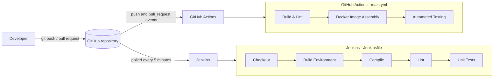

# ACEest Fitness & Gym

[](https://github.com/ab089-repo/Aceest-Code/actions/workflows/main.yml)

A Flask web application for gym management, delivered with an automated CI/CD workflow:
Pytest for validation, Docker for packaging, GitHub Actions for the pipeline and Jenkins as a
second, independent build gate.

The application is a web port of the ACEest desktop baseline. It serves the three ACEest
training programs with their workout and diet plans, estimates daily calories from body
weight, stores client profiles in SQLite and tracks each client's weekly adherence.

## Contents

- [Project structure](#project-structure)
- [Local setup and execution](#local-setup-and-execution)
- [API reference](#api-reference)
- [Running the tests manually](#running-the-tests-manually)
- [Docker](#docker)
- [CI/CD overview](#cicd-overview)
- [Running Jenkins locally](#running-jenkins-locally)
- [Version control conventions](#version-control-conventions)

## Project structure

```text
.
├── app.py                       Flask application: factory, routes, validation, SQLite access
├── templates/index.html         Dashboard page
├── tests/                       Pytest suite
├── requirements.txt             Runtime dependencies (Flask, gunicorn)
├── requirements-dev.txt         Runtime dependencies plus flake8, pytest and pytest-cov
├── pytest.ini, .flake8          Test and lint configuration
├── Dockerfile, .dockerignore    Multi-stage image with runtime and test targets
├── .github/workflows/main.yml   GitHub Actions pipeline
├── Jenkinsfile                  Jenkins pipeline
└── jenkins/                     Jenkins controller defined as code
```

## Local setup and execution

**Prerequisites:** Python 3.12 and Git. Docker is only needed for the container and Jenkins
sections.

1. Clone the repository.

   ```bash
   git clone https://github.com/ab089-repo/Aceest-Code.git
   cd Aceest-Code
   ```

2. Create and activate a virtual environment.

   ```powershell
   # Windows (PowerShell)
   python -m venv devops_venv
   .\devops_venv\Scripts\Activate.ps1
   ```

   ```bash
   # macOS / Linux
   python3 -m venv devops_venv
   source devops_venv/bin/activate
   ```

3. Install the dependencies. `requirements-dev.txt` includes the runtime dependencies as
   well as the lint and test tools.

   ```bash
   pip install -r requirements-dev.txt
   ```

4. Start the application.

   ```bash
   python app.py
   ```

5. Open <http://127.0.0.1:5000> for the dashboard, or call the API:

   ```bash
   curl http://127.0.0.1:5000/health
   curl "http://127.0.0.1:5000/api/calories?weight=70&program=MG"
   curl -X POST http://127.0.0.1:5000/api/clients \
        -H "Content-Type: application/json" \
        -d '{"name": "Arun Kumar", "age": 28, "weight": 72.5, "program": "FL"}'
   ```

### Configuration

The application is configured through environment variables. All of them are optional.

| Variable    | Default             | Purpose                                         |
|-------------|---------------------|-------------------------------------------------|
| `ACEEST_DB` | `aceest_fitness.db` | Path of the SQLite database file                |
| `HOST`      | `127.0.0.1`         | Address `python app.py` listens on              |
| `PORT`      | `5000`              | Port `python app.py` listens on                 |

The database file and its tables are created automatically on first start.

## API reference

Programs are identified by a code: `FL` (Fat Loss), `MG` (Muscle Gain) or `BG` (Beginner).

| Method | Path                           | Description                                         |
|--------|--------------------------------|-----------------------------------------------------|
| GET    | `/`                            | HTML dashboard listing programs and saved clients   |
| GET    | `/health`                      | Health check                                        |
| GET    | `/api/programs`                | All programs with workout and diet plans            |
| GET    | `/api/programs/<code>`         | One program                                         |
| GET    | `/api/calories`                | Calorie estimate for `?weight=<kg>&program=<code>`  |
| GET    | `/api/clients`                 | All clients, sorted by name                         |
| POST   | `/api/clients`                 | Create a client, or update the one with that name   |
| GET    | `/api/clients/<name>`          | One client                                          |
| POST   | `/api/clients/<name>/progress` | Log this week's adherence, `{"adherence": 0-100}`   |
| GET    | `/api/clients/<name>/progress` | Adherence history for a client                      |

A client needs a `name`, a `program` code and a positive `weight` in kilograms; `age` is
optional. Daily calories are calculated as weight multiplied by the program's calorie factor
(FL 22, MG 35, BG 26).

Errors are returned as JSON in the form `{"error": "<message>"}` with status 400 for invalid
input, 404 for an unknown program, client or route, and 405 for an unsupported method.

## Running the tests manually

With the virtual environment active, from the repository root:

```bash
pytest                                             # run the whole suite
pytest --cov=app --cov-report=term-missing         # with a coverage report
pytest tests/test_clients.py                       # one file
pytest -k "calorie"                                # tests matching a keyword
flake8                                             # lint
python -m compileall -q app.py tests               # syntax check
```

The suite has 122 tests and covers 99% of `app.py`. Each test runs against its own temporary
SQLite database, so tests never touch local data and can run in any order.

| File                     | What it covers                                                       |
|--------------------------|----------------------------------------------------------------------|
| `tests/test_logic.py`    | Calorie estimate, week labels, program parsing and input validation  |
| `tests/test_programs.py` | Program catalogue and calorie estimate endpoints                     |
| `tests/test_clients.py`  | Saving, updating and loading clients; weekly adherence               |
| `tests/test_app.py`      | Application setup, persistence, dashboard page and error responses   |

To run the same suite inside a container, as the pipeline does:

```bash
docker build --target test -t aceest-fitness:test .
docker run --rm aceest-fitness:test
```

## Docker

```bash
docker build -t aceest-fitness .
docker run --rm -p 5000:5000 -v aceest-data:/data aceest-fitness
```

The application is then available at <http://127.0.0.1:5000>. The named volume keeps the
database between container restarts.

The `Dockerfile` has three stages:

| Stage     | Purpose                                                                             |
|-----------|-------------------------------------------------------------------------------------|
| `app`     | Runtime dependencies and application code, shared by the two targets below          |
| `test`    | Adds the dev dependencies and the test suite; `docker run` executes Pytest          |
| `runtime` | Default target; serves the application with gunicorn                                |

Choices made for image size and security:

- **Small base image.** `python:3.12-alpine` gives a runtime image of about 93 MB.
- **Test tooling stays out of the runtime image.** pytest and flake8 are installed only in
  the `test` stage.
- **Layer caching.** Dependencies are installed before the source is copied, so code changes
  do not reinstall them.
- **Non-root user.** The process runs as an unprivileged user (UID 10001) that can only
  write to `/data`.
- **Production server.** gunicorn serves the application instead of the Flask development
  server.
- **Health check.** The image declares a `HEALTHCHECK` against `/health`.
- **Minimal build context.** `.dockerignore` excludes the virtual environment, Git data and
  local databases.

The container also runs with a read-only root filesystem and no Linux capabilities:

```bash
docker run --rm -p 5000:5000 -v aceest-data:/data \
  --read-only --tmpfs /tmp --cap-drop ALL --security-opt no-new-privileges \
  aceest-fitness
```

## CI/CD overview

Every change is validated twice, by two independent systems that both read their
instructions from this repository.



### GitHub Actions

Defined in [`.github/workflows/main.yml`](.github/workflows/main.yml). The workflow runs on
every `push` and every `pull_request`, on any branch. Its three jobs run in sequence, and a
failure stops the jobs after it.

| Job                       | What it does                                                               |
|---------------------------|----------------------------------------------------------------------------|
| **Build & Lint**          | Installs the dependencies, compiles the sources and runs flake8            |
| **Docker Image Assembly** | Builds the runtime image, starts a container and checks `/health`          |
| **Automated Testing**     | Builds the `test` image and runs the Pytest suite inside the container     |

Results appear on the repository's **Actions** tab and next to each commit and pull request.

### Jenkins

Defined in the [`Jenkinsfile`](Jenkinsfile). Jenkins is the build server and acts as a second
quality gate: it pulls the latest code from GitHub and builds the environment from nothing,
outside Docker, so the result does not depend on anything the first pipeline produced.

| Stage                 | What it does                                                          |
|-----------------------|-----------------------------------------------------------------------|
| **Checkout**          | Empties the workspace and clones the `main` branch from GitHub        |
| **Build Environment** | Creates a fresh virtual environment and installs the dependencies     |
| **Compile**           | Byte-compiles the application and tests to catch syntax errors        |
| **Lint**              | Runs flake8                                                           |
| **Unit Tests**        | Runs Pytest with coverage and publishes the results as a JUnit report |

Jenkins runs on a local machine, where GitHub cannot deliver webhooks, so the pipeline polls
the repository every five minutes and starts a build when `main` has new commits.

### How the two fit together

| Aspect            | GitHub Actions                        | Jenkins                                    |
|-------------------|---------------------------------------|--------------------------------------------|
| Role              | Primary CI pipeline                   | Secondary build and quality gate           |
| Trigger           | Every push and pull request           | New commits on `main`, found by polling    |
| Runs on           | GitHub-hosted runner                  | Self-hosted Jenkins controller             |
| Validates         | The container image and the tests in it | A clean environment built from source    |
| Defined in        | `.github/workflows/main.yml`          | `Jenkinsfile`                              |

## Running Jenkins locally

The `jenkins/` directory defines the build server as code, so no manual configuration in the
Jenkins UI is needed:

| File                         | Purpose                                                           |
|------------------------------|-------------------------------------------------------------------|
| `jenkins/Dockerfile`         | Jenkins LTS image with Python and the required plugins            |
| `jenkins/plugins.txt`        | Plugins installed into the image                                  |
| `jenkins/casc.yaml`          | Configuration as Code: admin user, security and the pipeline job  |
| `jenkins/docker-compose.yml` | Starts the controller on port 8080 with a persistent volume       |

1. Set the admin password. The `.env` file is ignored by Git.

   ```bash
   cd jenkins
   cp .env.example .env        # then edit .env and choose a password
   ```

2. Build and start Jenkins. The first build of the image takes a few minutes.

   ```bash
   docker compose up -d --build
   ```

3. Open <http://localhost:8080> and sign in with the credentials from `.env`.

4. Open the **aceest-fitness-build** job, which already exists, and choose **Build Now**.
   The first build registers the polling trigger; later builds start automatically when
   `main` changes.

To stop the server, run `docker compose down`. Add `-v` to also delete the Jenkins data
volume.

To build a fork instead, set `ACEEST_REPO_URL` in `jenkins/.env` to its clone URL.

## Version control conventions

- `main` always holds working, tested code.
- Work is done on short-lived branches named by purpose and merged into `main` with a merge
  commit, so each piece of work stays visible in the history:

  | Prefix     | Used for                        | Example             |
  |------------|---------------------------------|---------------------|
  | `feature/` | Application and test code       | `feature/flask-app` |
  | `infra/`   | Docker, CI and Jenkins          | `infra/docker`      |
  | `docs/`    | Documentation                   | `docs/readme`       |

- Commit messages follow the [Conventional Commits](https://www.conventionalcommits.org/)
  style: a type prefix (`feat`, `fix`, `test`, `build`, `ci`, `docs`, `chore`), a short
  imperative summary, and a body explaining the reason when it is not obvious.
